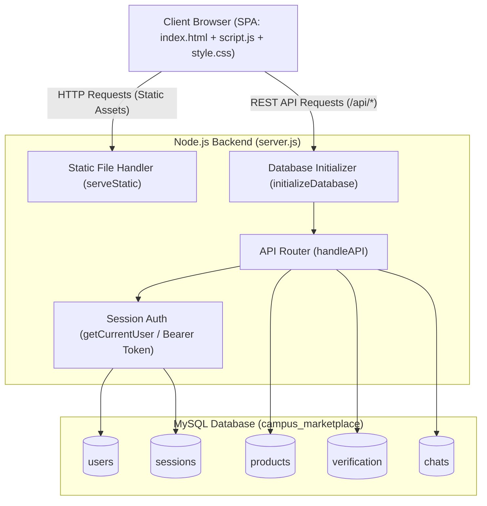

# 🎓 Campus Marketplace — Comprehensive Project Documentation

A full-stack, secure, student-to-student peer marketplace platform engineered for university campuses. Enables verified students to buy, sell, and exchange textbooks, electronics, dorm furniture, and academic accessories with built-in student verification and peer-to-peer chat.

---

## 📋 Table of Contents
1. [Project Overview](#-project-overview)
2. [Key Highlights & Architectural Features](#-key-highlights--architectural-features)
3. [Technology Stack](#-technology-stack)
4. [System Architecture](#-system-architecture)
5. [Database Schema & Data Models](#-database-schema--data-models)
6. [Core Modules & Functionality](#-core-modules--functionality)
7. [API Specification & Endpoints](#-api-specification--endpoints)
8. [Frontend Design & UI/UX](#-frontend-design--uiux)
9. [Project Directory Structure](#-project-directory-structure)
10. [Setup & Execution Guide](#-setup--execution-guide)
11. [Security & Optimization Practices](#-security--optimization-practices)
12. [Dual-Mode Architecture (MySQL vs. Offline JSON)](#-dual-mode-architecture)

---

## 🌟 Project Overview

**Campus Marketplace** solves a pervasive problem faced by university students: safely buying and selling pre-owned academic resources (textbooks, scientific calculators, stationery, dorm essentials) within a trusted campus community.

### Key Objectives:
- **Campus Trust & Safety**: Mitigate fraudulent sellers through a mandatory/verified student identification badge system (`verified` status).
- **Zero-Friction Communication**: In-app, product-anchored chat system that lets buyers query sellers without revealing personal phone numbers or external social media handles.
- **Lightweight & High Performance**: Clean native architecture using pure HTML5, modern Liquid Glassmorphism CSS, Vanilla JavaScript, and a dependency-minimal Node.js server.
- **Cloud & Offline Ready**: Configured for MySQL production databases and serverless cloud deployment (Vercel) alongside an offline JSON-backed development mode.

---

## ⚡ Key Highlights & Architectural Features

- **No Heavy Frontend Frameworks**: Built using Vanilla JavaScript SPA (Single Page Application) navigation, ensuring instantaneous load times without React/Vue overhead.
- **Native Node.js Server**: Core HTTP server written using Node.js's native `http` module, avoiding Express bloat while delivering custom body parsing, route matching, static asset streaming, and error handling.
- **Stateless Bearer Token Authentication**: Secure token-based session management mapped directly in MySQL sessions table with SHA-256 password hashing.
- **Serverless-Ready File Handling**: Verification documents (college ID cards, admission slips) are parsed as Base64 data streams and persisted directly in MySQL `LONGTEXT` columns, eliminating local ephemeral filesystem loss on serverless hosts like Vercel.
- **Auto-Bootstrapping Database**: On server startup, the system creates missing tables (`sessions`, `users`, `products`, `verification`, `chats`), adds required schema columns dynamically, and seeds initial demo products and a demo student account.

---

## 🛠 Technology Stack

### Frontend
| Component | Technology | Description |
| :--- | :--- | :--- |
| **Markup** | HTML5 | Semantic structure with accessible modal dialogs and dynamic containers |
| **Styling** | Vanilla CSS3 | Liquid Glassmorphism, backdrop filters, keyframe ambient glow animations, responsive grid/flexbox |
| **Logic** | Vanilla ES6+ JS | Hashless SPA routing, asynchronous Fetch API client, LocalStorage state persistence |
| **Icons & Media** | Native Emojis & Base64 | Zero external CDN icon font dependencies |

### Backend & Database
| Component | Technology | Description |
| :--- | :--- | :--- |
| **Runtime** | Node.js (v18+) | Native `http`, `crypto`, `fs`, `path` modules |
| **Database** | MySQL (v8.0+) | Relational database with `mysql2/promise` connection pooling |
| **Config** | `dotenv` | Environment variable management for credentials and ports |
| **Hashing** | `crypto` (SHA-256) | Cryptographic password hashing and token generation (`randomBytes`) |

---

## 🏛 System Architecture



---

## 🗄 Database Schema & Data Models

The application utilizes 5 primary relational tables inside MySQL:

### 1. `users` Table
Stores registered student user accounts.
```sql
CREATE TABLE IF NOT EXISTS users (
    id INT AUTO_INCREMENT PRIMARY KEY,
    name VARCHAR(100) NOT NULL,
    email VARCHAR(255) UNIQUE NOT NULL,
    password_hash VARCHAR(64) NOT NULL,
    verified TINYINT(1) DEFAULT 0,
    created_at TIMESTAMP DEFAULT CURRENT_TIMESTAMP
);
```

### 2. `sessions` Table
Manages active authentication sessions and tokens.
```sql
CREATE TABLE IF NOT EXISTS sessions (
    token VARCHAR(255) PRIMARY KEY,
    user_id INT NOT NULL,
    created_at TIMESTAMP DEFAULT CURRENT_TIMESTAMP,
    FOREIGN KEY (user_id) REFERENCES users(id) ON DELETE CASCADE
);
```

### 3. `products` Table
Stores items listed for sale by students.
```sql
CREATE TABLE IF NOT EXISTS products (
    id INT AUTO_INCREMENT PRIMARY KEY,
    name VARCHAR(255) NOT NULL,
    category VARCHAR(100) NOT NULL,
    price DECIMAL(10, 2) NOT NULL,
    description TEXT NOT NULL,
    seller_id INT NOT NULL,
    created_at TIMESTAMP DEFAULT CURRENT_TIMESTAMP,
    FOREIGN KEY (seller_id) REFERENCES users(id) ON DELETE CASCADE
);
```

### 4. `verification` Table
Records student ID verification submissions and Base64-encoded document data.
```sql
CREATE TABLE IF NOT EXISTS verification (
    id INT AUTO_INCREMENT PRIMARY KEY,
    user_id INT NOT NULL,
    student_name VARCHAR(100) NOT NULL,
    student_email VARCHAR(255) NOT NULL,
    student_id VARCHAR(50) NOT NULL,
    department VARCHAR(100) NOT NULL,
    document_name VARCHAR(255) NOT NULL,
    document_path VARCHAR(255) DEFAULT 'mysql',
    document_data LONGTEXT NULL,
    status ENUM('pending', 'verified', 'rejected') DEFAULT 'pending',
    created_at TIMESTAMP DEFAULT CURRENT_TIMESTAMP,
    FOREIGN KEY (user_id) REFERENCES users(id) ON DELETE CASCADE
);
```

### 5. `chats` Table
Stores direct messages exchanged between prospective buyers and sellers.
```sql
CREATE TABLE IF NOT EXISTS chats (
    id INT AUTO_INCREMENT PRIMARY KEY,
    product_id INT NOT NULL,
    sender_id INT NOT NULL,
    message TEXT NOT NULL,
    created_at TIMESTAMP DEFAULT CURRENT_TIMESTAMP,
    FOREIGN KEY (product_id) REFERENCES products(id) ON DELETE CASCADE,
    FOREIGN KEY (sender_id) REFERENCES users(id) ON DELETE CASCADE
);
```

---

## 🧩 Core Modules & Functionality

### 1. User Authentication Module
- **Registration**: Validates input lengths (name, email, min 6-char password), checks for email collision, hashes password using SHA-256, generates a 32-byte hexadecimal bearer token, and initializes a session.
- **Login**: Verifies credentials against stored SHA-256 hashes, generates session tokens, and persists user state in client `localStorage`.
- **Session Verification**: The `/api/me` route verifies token integrity on page reload to maintain persistent login states.
- **Logout**: Invalidates the active token in both the database `sessions` table and browser storage.

### 2. Marketplace & Product Discovery Module
- **Browse & Filter**: Lists all items with seller name and verification badges.
- **Category Filter**: Instant filtering by categories (`Books`, `Electronics`, `Furniture`, `Accessories`).
- **Live Search**: Full-text client/server search filtering matching title, category, or description.
- **Product Details Modal**: Displays rich details, description, seller status, and quick-action buttons.

### 3. Sell / Item Listing Module
- Allows logged-in students to list pre-owned items.
- Form inputs: Product Title, Category Selector, Price (INR ₹), Description.
- Automatically associates the product with the authenticated seller's `id`.

### 4. Student Verification System
- Students submit their institutional details (Name, College Email, Roll/Student ID, Department) and upload an image/document of their College ID card.
- The document is converted to Base64 in the browser (`FileReader`) and safely sent within a 4MB capped payload to be saved in MySQL.
- Once submitted, the seller profile is flagged for verified status, unlocking the `✓ Verified Seller` badge across listings.

### 5. Product-Anchored Chat Module
- Directly initiated from any product card by clicking **Contact Seller**.
- Chats are scoped to specific `productId`s, ensuring conversations retain transactional context.
- Live message thread display with automatic scrolling to the latest message.

---

## 📡 API Specification & Endpoints

Base URL: `http://localhost:3000/api`

### Health Check
| Method | Endpoint | Description | Auth Required |
| :--- | :--- | :--- | :--- |
| `GET` | `/api/health` | Verifies server and MySQL database connectivity | No |

**Response (200 OK):**
```json
{
  "success": true,
  "message": "Campus Marketplace API is running",
  "database": "MySQL"
}
```

---

### Authentication
| Method | Endpoint | Description | Auth Required |
| :--- | :--- | :--- | :--- |
| `POST` | `/api/auth/register` | Register new student account | No |
| `POST` | `/api/auth/login` | Authenticate existing user | No |
| `POST` | `/api/auth/logout` | Revoke active session token | Yes (Bearer) |
| `GET` | `/api/me` | Fetch authenticated student profile | Yes (Bearer) |

#### Register Request Body:
```json
{
  "name": "Alex Mercer",
  "email": "alex@campus.edu",
  "password": "securePassword123"
}
```

#### Login Request Body:
```json
{
  "email": "student@campus.local",
  "password": "student123"
}
```

#### Auth Success Response (200/201):
```json
{
  "success": true,
  "token": "a1b2c3d4e5f6...",
  "user": {
    "id": 1,
    "name": "Demo Student",
    "email": "student@campus.local",
    "verified": true
  }
}
```

---

### Products
| Method | Endpoint | Description | Auth Required |
| :--- | :--- | :--- | :--- |
| `GET` | `/api/products` | Retrieve products (supports `?search=` and `?category=`) | No |
| `GET` | `/api/products/:id` | Retrieve single product details | No |
| `POST` | `/api/products` | List a new item for sale | Yes (Bearer) |

#### Create Product Request Body:
```json
{
  "name": "Casio FX-991EX Scientific Calculator",
  "category": "Electronics",
  "price": 850,
  "description": "Like new condition, used for only one semester."
}
```

---

### Verification
| Method | Endpoint | Description | Auth Required |
| :--- | :--- | :--- | :--- |
| `POST` | `/api/verification` | Submit college ID for verification | Yes (Bearer) |

#### Verification Request Body:
```json
{
  "studentName": "Alex Mercer",
  "studentEmail": "alex@campus.edu",
  "studentId": "STU99201",
  "department": "Computer Science",
  "documentName": "student_id_card.png",
  "documentData": "data:image/png;base64,iVBORw0KGgoAAA..."
}
```

---

### Chat & Messaging
| Method | Endpoint | Description | Auth Required |
| :--- | :--- | :--- | :--- |
| `GET` | `/api/chats/:productId` | Retrieve chat message history for a product | Yes (Bearer) |
| `POST` | `/api/chats/:productId` | Send a new message to the product seller | Yes (Bearer) |

#### Send Message Request Body:
```json
{
  "message": "Hi, is this textbook still available for pickup at the campus library?"
}
```

---

## 🎨 Frontend Design & UI/UX

The interface is built with an aesthetic **Liquid Glassmorphism** design theme:
- **Color Palette**: Deep dark background (`#090914`), vibrant violet (`#7c3aed`), cyan (`#06b6d4`), and translucent glass cards.
- **Ambient Micro-Animations**: Three floating radial gradient spheres (`.circle-one`, `.circle-two`, `.circle-three`) that softly drift in the background with CSS keyframe interpolation.
- **Glassmorphism Components**: Translucent backdrop blur (`backdrop-filter: blur(16px)`), subtle borders (`rgba(255, 255, 255, 0.1)`), and dynamic hover elevation effects.
- **Single Page Navigation**: Seamless tab switching between `Home`, `Marketplace`, `Sell`, `Verification`, `Chat`, and `Login` without full page refreshes.
- **Mobile Responsive**: Flexible grid layouts (`product-grid`) that automatically adapt from desktop multi-column to tablet and mobile single-column views.

---

## 📂 Project Directory Structure

```plaintext
Campus_Marketplace_Final/
├── .env                               # Environment configurations (MySQL host, port, credentials)
├── .gitignore                         # Git exclusion rules (node_modules, logs)
├── package.json                       # Project manifest (dependencies: mysql2, dotenv)
├── package-lock.json                  # Locked dependency graph
├── server.js                          # Core Node.js backend server with MySQL & static file serving
├── DOCUMENTATION.md                   # Complete architectural & functional documentation
│
├── public/                            # Static frontend assets
│   ├── index.html                     # Main SPA markup (Home, Products, Sell, Verify, Chat, Login)
│   ├── script.js                      # Client application logic, API fetch client, DOM routing
│   └── style.css                      # Liquid Glass UI stylesheet, design tokens, animations
│
├── uploads/                           # Local storage directory fallback for uploads
│
└── Campus_Marketplace_Final/          # Standalone Offline Prototype Build
    ├── README.md                      # Quick start guide for offline version
    ├── start.bat                      # Windows double-click launcher
    ├── server_backup.js               # Standalone file-backed server (no MySQL needed)
    ├── package.json                   # Prototype manifest
    ├── data/
    │   └── db.json                    # File-based JSON database (users, products, chats)
    └── public/                        # Backup frontend assets
```

---

## 🚀 Setup & Execution Guide

### Prerequisites
- **Node.js**: v18.0.0 or later installed (`node -v`)
- **MySQL**: MySQL Server 8.0+ running locally (e.g., via MySQL Workbench, XAMPP, or native service)

### 1. Configure Environment Variables
Open or edit the [`.env`](file:///c:/Users/Downe/OneDrive/Documents/Campus_Marketplace_Final/.env) file in the project root:

```env
DB_HOST=localhost
DB_PORT=3306
DB_USER=root
DB_PASSWORD=your_mysql_password
DB_NAME=campus_marketplace
PORT=3000
```

> **Note**: Ensure the database `campus_marketplace` exists in MySQL:
> ```sql
> CREATE DATABASE campus_marketplace;
> ```
> The server will automatically create all tables and seed default products on the first run.

### 2. Install Dependencies
```bash
npm install
```

### 3. Launch the Server
```bash
node server.js
```

### 4. Access the Application
Open your web browser and navigate to:
```
http://localhost:3000
```

### 5. Default Demo Credentials
- **Email**: `student@campus.local`
- **Password**: `student123`
*(Or click "Create account" on the login screen to register any new student profile)*

---

## 🔒 Security & Optimization Practices

1. **SQL Injection Prevention**: All queries use parameterized SQL prepared statements via `pool.execute(query, params)`.
2. **XSS (Cross-Site Scripting) Defense**: All user-provided data rendered on the frontend is escaped through the client-side `esc()` helper function before DOM injection.
3. **Payload Capping (DoS Prevention)**: The server limits inbound request payloads to `4 MB` (`MAX_BODY_SIZE`), protecting memory and avoiding serverless timeouts during file uploads.
4. **Directory Traversal Protection**: The static file server (`serveStatic`) checks that resolved paths strictly reside within the `public/` directory root.
5. **Secure Cryptographic Hashing**: User passwords are encrypted with SHA-256 before database insertion; session tokens are generated using cryptographically secure random bytes (`crypto.randomBytes(32)`).

---

## 🔄 Dual-Mode Architecture

This repository includes both a **Production-Ready Relational Build** and an **Offline Demonstration Build**:

| Feature | Primary Build (`server.js`) | Offline Fallback (`Campus_Marketplace_Final/`) |
| :--- | :--- | :--- |
| **Database** | MySQL (Connection Pooling) | File-backed JSON (`data/db.json`) |
| **Requirements** | Node.js + MySQL Server | Node.js only (Zero DB setup needed) |
| **Cloud Deployment**| Vercel / Railway / AWS compatible | Local / Offline demo |
| **File Storage** | Stored in MySQL `LONGTEXT` | Stored in local `uploads/` folder |
| **Best For** | Scalable submission, production hosting | Instant offline presentation / evaluator grading |

To run the offline version at any time, simply navigate to the inner folder and run `start.bat` or `node server_backup.js`.
