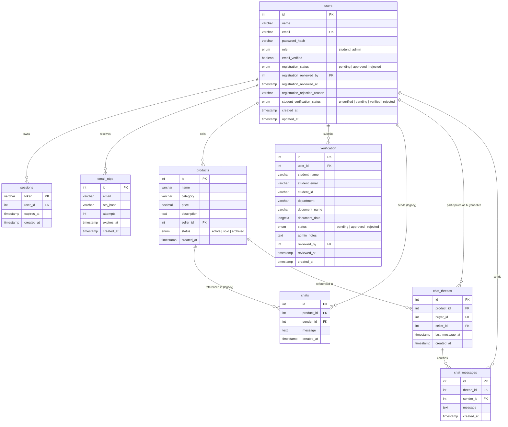

# 🗄 Database Design Document — Campus Marketplace

- **Project Name:** Campus Marketplace
- **Document Version:** 1.0
- **Status:** Draft / Pending User Approval
- **Cross-References:** [PRD.md](file:///c:/Users/Downe/OneDrive/Documents/Campus_Marketplace_Final/docs/PRD.md) | [SRS.md](file:///c:/Users/Downe/OneDrive/Documents/Campus_Marketplace_Final/docs/SRS.md) | [TRD.md](file:///c:/Users/Downe/OneDrive/Documents/Campus_Marketplace_Final/docs/TRD.md) | [SECURITY_PLAN.md](file:///c:/Users/Downe/OneDrive/Documents/Campus_Marketplace_Final/docs/SECURITY_PLAN.md)

---

## 1. Current Database Schema (Audit Baseline)

As verified in [server.js:L342-L526](file:///c:/Users/Downe/OneDrive/Documents/Campus_Marketplace_Final/server.js#L342-L526), the current MySQL database (`campus_marketplace`) consists of 5 tables:

### 1.1. Existing Table Definitions
- **`users`**:
  - `id INT AUTO_INCREMENT PRIMARY KEY`
  - `name VARCHAR(100) NOT NULL`
  - `email VARCHAR(255) UNIQUE NOT NULL`
  - `password_hash VARCHAR(64) NOT NULL` (Holds 64-char hex string from unsalted SHA-256)
  - `verified TINYINT(1) DEFAULT 0`
  - `created_at TIMESTAMP DEFAULT CURRENT_TIMESTAMP`
- **`sessions`**:
  - `token VARCHAR(255) PRIMARY KEY`
  - `user_id INT NOT NULL` (FK to `users(id) ON DELETE CASCADE`)
  - `created_at TIMESTAMP DEFAULT CURRENT_TIMESTAMP`
- **`products`**:
  - `id INT AUTO_INCREMENT PRIMARY KEY`
  - `name VARCHAR(255) NOT NULL`
  - `category VARCHAR(100) NOT NULL`
  - `price DECIMAL(10,2) NOT NULL`
  - `description TEXT NOT NULL`
  - `seller_id INT NOT NULL` (FK to `users(id)`)
  - `created_at TIMESTAMP DEFAULT CURRENT_TIMESTAMP`
- **`verification`**:
  - `id INT AUTO_INCREMENT PRIMARY KEY`
  - `user_id INT NOT NULL` (FK to `users(id)`)
  - `student_name VARCHAR(100) NOT NULL`
  - `student_email VARCHAR(255) NOT NULL`
  - `student_id VARCHAR(50) NOT NULL`
  - `department VARCHAR(100) NOT NULL`
  - `document_name VARCHAR(255) NOT NULL`
  - `document_path VARCHAR(255) DEFAULT 'mysql'`
  - `document_data LONGTEXT NULL` (Holds Base64 file payload)
  - `status VARCHAR(20) DEFAULT 'pending'`
  - `created_at TIMESTAMP DEFAULT CURRENT_TIMESTAMP`
- **`chats`**:
  - `id INT AUTO_INCREMENT PRIMARY KEY`
  - `product_id INT NOT NULL`
  - `sender_id INT NOT NULL`
  - `message TEXT NOT NULL`
  - `created_at TIMESTAMP DEFAULT CURRENT_TIMESTAMP`

---

## 2. Identified Structural Limitations

1. **Missing RBAC Role Column**: `users` has no `role` column, making admin permission checking impossible at the schema level.
2. **Conflated Account Statuses**: A single `verified TINYINT(1)` flag is used to represent both student identity and general account verification. There are no fields for tracking email OTP verification or admin registration approvals.
3. **Password Hash Size Limit**: `password_hash VARCHAR(64)` fits SHA-256 (64 hex characters) but cannot accommodate `bcrypt` hashes, which require up to 72–255 characters.
4. **Indefinite Sessions**: `sessions` table has no `expires_at` column, preventing server-enforced session timeout.
5. **Missing OTP Storage**: There is no table to record one-time passwords, timestamps, and attempt counters.
6. **Chat Data Leakage (Missing Thread Model)**: `chats` only contains `product_id` and `sender_id`. All messages for a product are dumped into one room. There is no `thread_id` or explicit `buyer_id` / `seller_id` pairing.

---

## 3. Proposed Relational Schema (Target State)

### 3.1. Entity-Relationship Diagram (ERD)



---

## 4. Complete SQL Data Definition Language (DDL)

```sql
-- ========================================================
-- CAMPUS MARKETPLACE — RELATIONAL SCHEMA SPECIFICATION
-- ========================================================

-- 1. USERS TABLE
CREATE TABLE IF NOT EXISTS users (
    id INT AUTO_INCREMENT PRIMARY KEY,
    name VARCHAR(100) NOT NULL,
    email VARCHAR(255) NOT NULL UNIQUE,
    password_hash VARCHAR(255) NOT NULL,
    role ENUM('student', 'admin') NOT NULL DEFAULT 'student',
    email_verified BOOLEAN NOT NULL DEFAULT 0,
    registration_status ENUM('pending', 'approved', 'rejected') NOT NULL DEFAULT 'pending',
    registration_reviewed_by INT NULL,
    registration_reviewed_at TIMESTAMP NULL,
    registration_rejection_reason VARCHAR(255) NULL,
    student_verification_status ENUM('unverified', 'pending', 'verified', 'rejected') NOT NULL DEFAULT 'unverified',
    created_at TIMESTAMP DEFAULT CURRENT_TIMESTAMP,
    updated_at TIMESTAMP DEFAULT CURRENT_TIMESTAMP ON UPDATE CURRENT_TIMESTAMP,
    FOREIGN KEY (registration_reviewed_by) REFERENCES users(id) ON DELETE SET NULL,
    INDEX idx_user_email (email),
    INDEX idx_reg_status (registration_status)
) ENGINE=InnoDB DEFAULT CHARSET=utf8mb4 COLLATE=utf8mb4_unicode_ci;

-- 2. EMAIL OTPS TABLE
CREATE TABLE IF NOT EXISTS email_otps (
    id INT AUTO_INCREMENT PRIMARY KEY,
    email VARCHAR(255) NOT NULL,
    otp_hash VARCHAR(64) NOT NULL,
    attempts TINYINT UNSIGNED NOT NULL DEFAULT 0,
    expires_at TIMESTAMP NOT NULL,
    created_at TIMESTAMP DEFAULT CURRENT_TIMESTAMP,
    INDEX idx_otp_email_expires (email, expires_at)
) ENGINE=InnoDB DEFAULT CHARSET=utf8mb4 COLLATE=utf8mb4_unicode_ci;

-- 3. SESSIONS TABLE
CREATE TABLE IF NOT EXISTS sessions (
    token VARCHAR(255) PRIMARY KEY,
    user_id INT NOT NULL,
    expires_at TIMESTAMP NOT NULL,
    created_at TIMESTAMP DEFAULT CURRENT_TIMESTAMP,
    FOREIGN KEY (user_id) REFERENCES users(id) ON DELETE CASCADE,
    INDEX idx_session_expiry (expires_at)
) ENGINE=InnoDB DEFAULT CHARSET=utf8mb4 COLLATE=utf8mb4_unicode_ci;

-- 4. PRODUCTS TABLE
CREATE TABLE IF NOT EXISTS products (
    id INT AUTO_INCREMENT PRIMARY KEY,
    name VARCHAR(255) NOT NULL,
    category VARCHAR(100) NOT NULL,
    price DECIMAL(10, 2) NOT NULL,
    description TEXT NOT NULL,
    seller_id INT NOT NULL,
    status ENUM('active', 'sold', 'archived') NOT NULL DEFAULT 'active',
    created_at TIMESTAMP DEFAULT CURRENT_TIMESTAMP,
    FOREIGN KEY (seller_id) REFERENCES users(id) ON DELETE CASCADE,
    INDEX idx_prod_category (category),
    INDEX idx_prod_status (status)
) ENGINE=InnoDB DEFAULT CHARSET=utf8mb4 COLLATE=utf8mb4_unicode_ci;

-- 5. VERIFICATION TABLE (Student ID Proof Submissions)
CREATE TABLE IF NOT EXISTS verification (
    id INT AUTO_INCREMENT PRIMARY KEY,
    user_id INT NOT NULL,
    student_name VARCHAR(150) NOT NULL,
    student_email VARCHAR(150) NOT NULL,
    student_id VARCHAR(100) NOT NULL,
    department VARCHAR(150) NOT NULL,
    document_name VARCHAR(255) NOT NULL,
    document_path VARCHAR(500) DEFAULT 'mysql',
    document_data LONGTEXT NULL,
    status ENUM('pending', 'approved', 'rejected') NOT NULL DEFAULT 'pending',
    admin_notes TEXT NULL,
    reviewed_by INT NULL,
    reviewed_at TIMESTAMP NULL,
    created_at TIMESTAMP DEFAULT CURRENT_TIMESTAMP,
    FOREIGN KEY (user_id) REFERENCES users(id) ON DELETE CASCADE,
    FOREIGN KEY (reviewed_by) REFERENCES users(id) ON DELETE SET NULL,
    INDEX idx_verif_user (user_id),
    INDEX idx_verif_status (status)
) ENGINE=InnoDB DEFAULT CHARSET=utf8mb4 COLLATE=utf8mb4_unicode_ci;

-- 6. LEGACY CHATS TABLE (Preserved for Backward Compatibility)
CREATE TABLE IF NOT EXISTS chats (
    id INT AUTO_INCREMENT PRIMARY KEY,
    product_id INT NOT NULL,
    sender_id INT NOT NULL,
    message TEXT NOT NULL,
    created_at TIMESTAMP DEFAULT CURRENT_TIMESTAMP,
    FOREIGN KEY (product_id) REFERENCES products(id) ON DELETE CASCADE,
    FOREIGN KEY (sender_id) REFERENCES users(id) ON DELETE CASCADE,
    INDEX idx_chats_product (product_id)
) ENGINE=InnoDB DEFAULT CHARSET=utf8mb4 COLLATE=utf8mb4_unicode_ci;

-- 7. CHAT THREADS TABLE (Scoped Buyer-Seller Product Pairing)
CREATE TABLE IF NOT EXISTS chat_threads (
    id INT AUTO_INCREMENT PRIMARY KEY,
    product_id INT NOT NULL,
    buyer_id INT NOT NULL,
    seller_id INT NOT NULL,
    last_message_at TIMESTAMP DEFAULT CURRENT_TIMESTAMP ON UPDATE CURRENT_TIMESTAMP,
    created_at TIMESTAMP DEFAULT CURRENT_TIMESTAMP,
    UNIQUE KEY uq_thread (product_id, buyer_id, seller_id),
    FOREIGN KEY (product_id) REFERENCES products(id) ON DELETE CASCADE,
    FOREIGN KEY (buyer_id) REFERENCES users(id) ON DELETE CASCADE,
    FOREIGN KEY (seller_id) REFERENCES users(id) ON DELETE CASCADE
) ENGINE=InnoDB DEFAULT CHARSET=utf8mb4 COLLATE=utf8mb4_unicode_ci;

-- 8. CHAT MESSAGES TABLE
CREATE TABLE IF NOT EXISTS chat_messages (
    id INT AUTO_INCREMENT PRIMARY KEY,
    thread_id INT NOT NULL,
    sender_id INT NOT NULL,
    message TEXT NOT NULL,
    created_at TIMESTAMP DEFAULT CURRENT_TIMESTAMP,
    FOREIGN KEY (thread_id) REFERENCES chat_threads(id) ON DELETE CASCADE,
    FOREIGN KEY (sender_id) REFERENCES users(id) ON DELETE CASCADE,
    INDEX idx_thread_msgs (thread_id, created_at)
) ENGINE=InnoDB DEFAULT CHARSET=utf8mb4 COLLATE=utf8mb4_unicode_ci;
```

---

## 5. Migration Strategy & Non-Destructive Data Retention

To ensure existing demo users (`student@campus.local`) and existing products are preserved without data loss:
1. **Dynamic Column Expansion**:
   ```sql
   ALTER TABLE users MODIFY COLUMN password_hash VARCHAR(255) NOT NULL;
   ALTER TABLE users ADD COLUMN IF NOT EXISTS role ENUM('student', 'admin') DEFAULT 'student';
   ALTER TABLE users ADD COLUMN IF NOT EXISTS email_verified BOOLEAN DEFAULT 0;
   ALTER TABLE users ADD COLUMN IF NOT EXISTS registration_status ENUM('pending', 'approved', 'rejected') DEFAULT 'pending';
   ALTER TABLE users ADD COLUMN IF NOT EXISTS student_verification_status ENUM('unverified', 'pending', 'verified', 'rejected') DEFAULT 'unverified';
   ```
2. **Backfill Existing Data**:
   - For demo accounts (`student@campus.local`), backfill `email_verified = 1`, `registration_status = 'approved'`, `student_verification_status = 'verified'`.
   - Seed default administrator account (`admin@campus.local`) with `role = 'admin'`.
3. **Sessions Migration**:
   - `ALTER TABLE sessions ADD COLUMN IF NOT EXISTS expires_at TIMESTAMP DEFAULT (CURRENT_TIMESTAMP + INTERVAL 1 DAY);`
4. **Chat Migration**:
   - Existing records in `chats` are migrated to `chat_threads` and `chat_messages` using the `product.seller_id` as the recipient.
