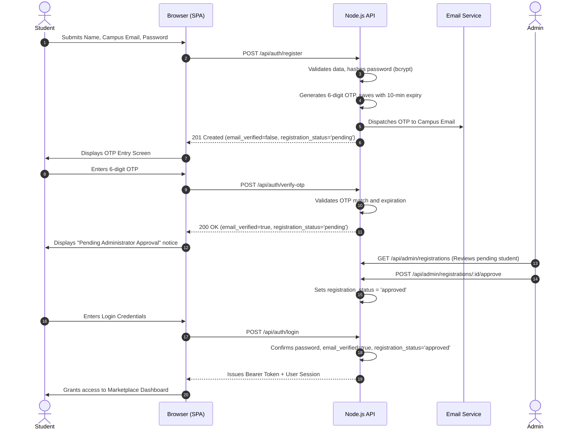

# 📄 Product Requirements Document (PRD) — Campus Marketplace

- **Project Name:** Campus Marketplace
- **Document Version:** 1.0 (Baseline from Audit)
- **Status:** Draft / Pending User Approval
- **Cross-References:** [SRS.md](file:///c:/Users/Downe/OneDrive/Documents/Campus_Marketplace_Final/docs/SRS.md) | [TRD.md](file:///c:/Users/Downe/OneDrive/Documents/Campus_Marketplace_Final/docs/TRD.md) | [WBS.md](file:///c:/Users/Downe/OneDrive/Documents/Campus_Marketplace_Final/docs/WBS.md) | [DATABASE_DESIGN.md](file:///c:/Users/Downe/OneDrive/Documents/Campus_Marketplace_Final/docs/DATABASE_DESIGN.md)

---

## 1. Executive Summary & Vision

**Campus Marketplace** is a student-centric peer-to-peer web application facilitating safe, affordable, and local exchange of academic resources (textbooks, calculators, electronics, hostel furniture, and accessories) within a university campus.

The platform addresses two fundamental friction points in current campus trading:
1. **Lack of Authenticity & Safety**: Anonymous public marketplaces expose students to fraudulent actors and non-students.
2. **Privacy Concerns**: Direct phone number and social media handle exchanges often expose students to unsolicited contact.

The platform solves these through **institutional email verification (OTP)**, **administrator registration approval**, **student ID proof verification**, and **scoped in-platform peer-to-peer messaging**.

---

## 2. Target Users & Personas

| Persona | Role | Key Needs & Pain Points |
| :--- | :--- | :--- |
| **Student Buyer** | Registered student looking for affordable second-hand academic items. | Needs to verify seller authenticity, search by category, view item condition, and contact sellers safely without exposing personal phone numbers. |
| **Student Seller** | Registered student looking to sell used coursework materials or dorm gear. | Needs an easy listing process, confidence that inquiries come from real students, and clear status tracking for their verified seller badge. |
| **Campus Administrator** | Campus staff/moderator overseeing trust, safety, and community compliance. | Needs a dedicated, secure dashboard to review and approve/reject registrations, inspect student ID uploads, and moderate product listings. |

---

## 3. Product Scope: Current vs. Proposed

### 3.1. Current Implemented Baseline (Verified by Audit)
- **Frontend**: Single Page Application (SPA) with tabbed navigation ([public/index.html](file:///c:/Users/Downe/OneDrive/Documents/Campus_Marketplace_Final/public/index.html)), Liquid Glassmorphism styling ([public/style.css](file:///c:/Users/Downe/OneDrive/Documents/Campus_Marketplace_Final/public/style.css)).
- **Catalog & Search**: Product listing cards, category filter pills (`Books`, `Electronics`, `Furniture`, `Accessories`), real-time keyword search, and item detail modal view.
- **Selling**: Product listing form capturing title, category, price, and description.
- **Basic Auth**: Plain email/password registration and login issuing 32-byte session tokens.
- **Verification Submission**: Upload form storing student ID details and Base64 document payload in MySQL `verification` table.
- **Chat Skeleton**: Product-associated chat endpoints (`/api/chats/:productId`).

### 3.2. Proposed & Mandatory New Features (This Roadmap)
- **Email OTP Verification**: Real delivery of a 6-digit one-time password to the student's institutional email address prior to account activation.
- **Admin Registration Approval / Rejection**: Independent gate where campus administrators review pending student registrations before granting access to the marketplace.
- **Three-Tier Separate Account Statuses**:
  1. `email_verified` (Boolean: true/false via OTP)
  2. `registration_status` (`pending`, `approved`, `rejected` via Administrator)
  3. `student_verification_status` (`unverified`, `pending`, `verified`, `rejected` via ID proof review)
- **Backend-Enforced Role-Based Access Control (RBAC)**: Enforcing `student` vs `admin` roles at the API level (rejecting unauthorized requests with HTTP `403 Forbidden`).
- **Scoped & Private Chat Architecture**: Chat threads isolated strictly between the specific prospective buyer and seller for a given product.
- **Admin Management Portal**: Administrative views for reviewing pending registrations, inspecting ID documents, approving/rejecting submissions with optional notes, and moderating flagged listings.

---

## 4. Feature Specifications & Preservation

### 4.1. Preserved Existing Features (Non-Negotiable)
- **Liquid Glassmorphism Design System**: Dark theme (`#090914`), floating ambient glow spheres (`.circle-one`, `.circle-two`), translucent glass cards, and micro-animations in [public/style.css](file:///c:/Users/Downe/OneDrive/Documents/Campus_Marketplace_Final/public/style.css).
- **Marketplace Browsing**: Grid layout, responsive cards, category filters, and detail modals.
- **Listing Engine**: Seller product creation with validation.
- **Lightweight Native Architecture**: Node.js backend using native `http` and `mysql2/promise` with zero heavy client frameworks.

### 4.2. Functional Scope Summary Table

| Feature Area | Current Baseline | Proposed Target | Scope State |
| :--- | :--- | :--- | :--- |
| **Email Verification** | None; email accepted without validation. | Real SMTP/API 6-digit OTP delivery with 10-minute expiry. | **NEW** |
| **Registration Approval** | None; immediate login upon registration. | Admin approval queue; login blocked until admin approves. | **NEW** |
| **Admin Access (RBAC)** | None; all users have identical privileges. | Role column (`student`, `admin`), backend authorization middleware. | **NEW** |
| **Student Verification** | Submission saved as `pending`; no review workflow; `users.verified` never updated. | Admin ID inspection workflow, status transition, verified seller badge activation. | **REFINED** |
| **Chat System** | Public per-product room; IDOR vulnerability; broken UI sender bubbles. | Scoped buyer-seller thread; authorized access only; correct bubble styling. | **REFINED** |
| **Marketplace Catalog** | Fully functional catalog, search, filter, details modal. | Preserve unchanged; add indicator for approved/unapproved seller status. | **PRESERVED** |
| **UI Aesthetics** | Liquid Glassmorphism dark mode. | Preserve completely across all new admin/OTP screens. | **PRESERVED** |

---

## 5. End-to-End User Journeys

### 5.1. Student Registration & Account Activation Journey

### 5.2. Student Identity Verification Journey (Verified Seller Badge)
1. **Submission**: Logged-in student navigates to `#verification`, provides Roll/PRN number, department, and uploads a College ID document (PNG/JPG/PDF).
2. **Payload Processing**: Client validates size (< 4 MB), converts document to Base64, and submits to `POST /api/verification`.
3. **Pending Review**: Backend sets `student_verification_status = 'pending'`. The user UI reflects "Verification Pending".
4. **Admin Review**: Administrator opens the Admin Dashboard, inspects the Base64 ID image, cross-checks name and roll number.
5. **Approval**: Admin clicks "Approve". Backend executes database transaction updating `verification_requests` status to `approved` and `users.student_verification_status = 'verified'`.
6. **Badge Display**: Student's listed products immediately display the `✓ Verified Seller` badge across the marketplace.

### 5.3. Buyer-Seller Discovery & Scoped Chat Journey
1. **Discovery**: Authenticated student filters catalog by `Books`, searches "Mathematics", and clicks **View Details**.
2. **Initiating Chat**: Buyer clicks **Contact Seller**.
3. **Thread Resolution**: Frontend calls `POST /api/chats/thread` with `productId`. The backend verifies if an existing thread exists between this `buyer_id`, `seller_id`, and `product_id`. If not, a new thread record is created.
4. **Messaging**: Buyer sends inquiry ("Is this available?"). Backend stores the message with `sender_id = buyer_id`.
5. **Seller View**: When the seller opens Chat, they view distinct buyer conversations grouped by product.
6. **Bubble Alignment**: Client correctly aligns messages: `sent` for current user's messages, `received` for the other party.

---

## 6. Success Metrics & Key Performance Indicators (KPIs)
- **Identity Trust Rate**: > 80% of active sellers holding a verified student badge within 30 days of campus launch.
- **Fraud Incidence**: 0 reported unauthorized non-student transactions.
- **Activation Funnel**: > 90% of students completing OTP verification within 5 minutes of registration.
- **Admin SLA**: Average registration and verification turnaround under 24 hours.
