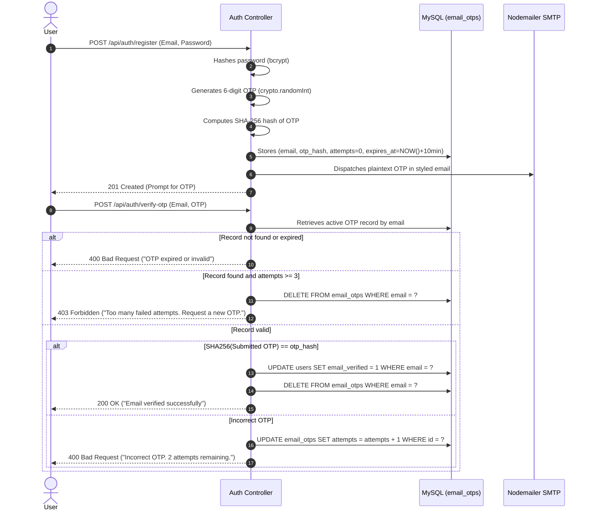

# 🛡 Security Plan — Campus Marketplace

- **Project Name:** Campus Marketplace
- **Document Version:** 1.0
- **Status:** Draft / Pending User Approval
- **Cross-References:** [PRD.md](file:///c:/Users/Downe/OneDrive/Documents/Campus_Marketplace_Final/docs/PRD.md) | [SRS.md](file:///c:/Users/Downe/OneDrive/Documents/Campus_Marketplace_Final/docs/SRS.md) | [TRD.md](file:///c:/Users/Downe/OneDrive/Documents/Campus_Marketplace_Final/docs/TRD.md) | [DATABASE_DESIGN.md](file:///c:/Users/Downe/OneDrive/Documents/Campus_Marketplace_Final/docs/DATABASE_DESIGN.md)

---

## 1. Threat Modeling & Vulnerability Baseline (From Audit)

During the codebase audit, the following security risks and architectural vulnerabilities were identified in the active [server.js](file:///c:/Users/Downe/OneDrive/Documents/Campus_Marketplace_Final/server.js):

| Identified Vulnerability | Current Source Location | Severity | Attack Vector & Impact |
| :--- | :--- | :---: | :--- |
| **Unsalted SHA-256 Passwords** | [server.js:L120-L124](file:///c:/Users/Downe/OneDrive/Documents/Campus_Marketplace_Final/server.js#L120-L124) | **CRITICAL** | Passwords hashed using single-round SHA-256 without salts. Trivial to reverse via rainbow tables if the database is leaked. |
| **Indefinite Session Lifespans**| [server.js:L348-L356](file:///c:/Users/Downe/OneDrive/Documents/Campus_Marketplace_Final/server.js#L348-L356) | **HIGH** | Bearer tokens in `sessions` never expire. Stolen tokens remain active indefinitely until manual logout. |
| **Chat IDOR (Data Leakage)** | [server.js:L1504-L1521](file:///c:/Users/Downe/OneDrive/Documents/Campus_Marketplace_Final/server.js#L1504-L1521) | **HIGH** | `GET /api/chats/:productId` returns all messages for a product without verifying if the caller is the buyer or seller. |
| **Unvalidated File Uploads** | [server.js:L1387-L1405](file:///c:/Users/Downe/OneDrive/Documents/Campus_Marketplace_Final/server.js#L1387-L1405) | **MEDIUM** | Accepts arbitrary Base64 strings up to 4 MB without verifying MIME type or magic bytes. |
| **Missing Rate Limiting** | [server.js:L601](file:///c:/Users/Downe/OneDrive/Documents/Campus_Marketplace_Final/server.js#L601) | **MEDIUM** | Auth routes have no IP or account-level throttling, exposing the app to brute force and spam registrations. |
| **No Admin Authorization** | Codebase-wide | **HIGH** | Zero RBAC; every registered user has identical rights. |

---

## 2. Authentication & Credential Hardening

### 2.1. Password Cryptography (`bcrypt`)
- **Algorithm**: `bcrypt` using 12 salt rounds.
- **Salting**: Generates a cryptographically random 128-bit salt per user automatically.
- **Work Factor**: 12 rounds (~250–350 ms per hash) balancing brute-force resistance with server responsiveness.
- **Password Policy**: Minimum 8 characters, maximum 72 characters (bcrypt limit), requiring at least one numeric digit and one symbol.

### 2.2. Session Token Management
- **Token Generation**: 32 cryptographically random bytes via `crypto.randomBytes(32).toString("hex")` (256 bits of entropy).
- **Session Expiry**: Sessions are issued with an explicit 24-hour expiration (`expires_at = NOW() + INTERVAL 24 HOUR`).
- **Validation**: On every authenticated request, `getCurrentUser()` validates that `s.expires_at > NOW()`. If expired, the token is revoked and HTTP `401 Unauthorized` is returned.
- **Revocation**: Logout triggers immediate database deletion (`DELETE FROM sessions WHERE token = ?`).

---

## 3. Email Verification & OTP Security Architecture



### 3.1. OTP Defense Mechanisms
- **Cryptographic Generation**: Uses `crypto.randomInt(100000, 999999)` to avoid pseudo-random predictability.
- **At-Rest Hash Storage**: Raw OTPs are NEVER saved in plaintext; only `SHA256(raw_otp)` is persisted in `email_otps`.
- **Short Time-to-Live (TTL)**: Strictly expires after 10 minutes.
- **Attempt Capping**: Maximum of 3 failed verification attempts before the OTP is voided.
- **Rate Limiting on Resend**: Enforces a minimum 60-second cooldown between resend requests, and a maximum of 5 OTP requests per hour per email address.

---

## 4. Role-Based Access Control (RBAC) & Admin Authorization

> [!IMPORTANT]
> **Core Architectural Principle:**
> Client-side visual suppression (hiding buttons or tabs in CSS/JS) is purely cosmetic. **All administrative actions MUST be strictly guarded by server-side middleware.**
> Roles are never read from client requests, request bodies, or trusted from cached token claims without fresh database verification.

### 4.1. Server-Side Permission Verification
```javascript
// Server-side RBAC Guard Pattern (requireAdmin)
async function requireAdmin(req, res) {
  const user = await getCurrentUser(req);
  if (!user) {
    sendJSON(res, 401, { success: false, message: "Authentication required." });
    return null;
  }

  // Always query database directly to verify role fresh on every call
  const [rows] = await pool.execute(
    "SELECT id, name, email, role, registration_status FROM users WHERE id = ? LIMIT 1",
    [user.id]
  );

  if (rows.length === 0 || rows[0].role !== "admin") {
    sendJSON(res, 403, { success: false, message: "Administrator authorization required. Access denied." });
    return null;
  }

  return { ...user, role: rows[0].role };
}
```

### 4.2. API Route Protection Matrix

| Route Pattern | Method | Access Condition | Unauthenticated Response | Unauthorized Student Response |
| :--- | :---: | :--- | :---: | :---: |
| `/api/products` | GET | Public | 200 OK | 200 OK |
| `/api/products` | POST | Authenticated + Email Verified + Registration Approved | 401 Unauthorized | **403 Forbidden** |
| `/api/verification` | POST | Authenticated + Email Verified + Registration Approved | 401 Unauthorized | **403 Forbidden** |
| `/api/chats/:id` | GET | Authenticated + Registration Approved | 401 Unauthorized | **403 Forbidden** |
| `/api/chats/:id` | POST | Authenticated + Email Verified + Registration Approved | 401 Unauthorized | **403 Forbidden** |
| `/api/admin/registrations` | GET | `role = 'admin'` (verified in DB) | 401 Unauthorized | **403 Forbidden** |
| `/api/admin/registrations/:id` | GET | `role = 'admin'` (verified in DB) | 401 Unauthorized | **403 Forbidden** |
| `/api/admin/registrations/:id/approve` | POST | `role = 'admin'` (verified in DB) | 401 Unauthorized | **403 Forbidden** |
| `/api/admin/registrations/:id/reject` | POST | `role = 'admin'` (verified in DB) | 401 Unauthorized | **403 Forbidden** |
| `/api/admin/registrations/:id/re-review`| POST | `role = 'admin'` (verified in DB) | 401 Unauthorized | **403 Forbidden** |

### 4.3. Registration Status Lifecycle & Transition Guardrails
- **States**: `pending` (initial on registration), `approved` (admin approved), `rejected` (admin rejected).
- **Guardrails**:
  - Direct transition from `rejected` to `approved` is blocked (`400 Bad Request`). An explicit re-review step (`POST /api/admin/registrations/:id/re-review`) is required.
  - Already approved or already rejected records reject duplicate transitions (`400 Bad Request`).
  - Administrator accounts cannot be modified via student registration endpoints (`400 Bad Request`).
  - When an admin rejects an account, all active user sessions are deleted from the `sessions` table immediately, revoking existing tokens in real time.
- **Status Decoupling**:
  - `email_verified`, `registration_status`, and `student_verification_status` are strictly independent.
  - OTP email verification updates only `email_verified = 1`; it does NOT approve the account.
  - Admin registration approval updates only `registration_status = 'approved'`; it does NOT verify email or student ID.
  - Both `email_verified = 1` AND `registration_status = 'approved'` are required for selling and student ID verification.

---

## 5. Chat Privacy & IDOR Prevention

### 5.1. Thread Access Isolation & Participant Authorization
To eliminate chat IDOR vulnerabilities and participant eavesdropping:
- Conversations are partitioned by `chat_threads` bound to `(product_id, buyer_id, seller_id)`.
- Client-supplied `sender_id`, `buyer_id`, `seller_id`, and `role` parameters are strictly ignored. The sender's identity is derived exclusively from the verified database session (`user.id`).
- When a buyer requests `/api/chats/:productId`, the server resolves only the thread matching `(product_id = ?, buyer_id = user.id, seller_id = product.seller_id)`. If no messages exist, an empty conversation is returned without disclosing any messages from other buyers.
- When a seller requests `/api/chats/:productId`, the server returns only threads for their own product. The seller cannot message themselves and cannot initiate fake buyer inquiries.
- Direct thread access via `/api/chats/thread/:threadId` verifies participant membership:
  ```javascript
  if (thread.buyer_id !== user.id && thread.seller_id !== user.id) {
    return sendJSON(res, 403, {
      success: false,
      message: "You are not authorized to view this conversation."
    });
  }
  ```
- Unrelated students probing conversation threads receive HTTP `403 Forbidden`. Nonexistent threads or products return HTTP `404 Not Found`.

### 5.2. Chat Authorization Matrix
| Chat Endpoint | Method | Required Auth | Minimum Status | Access Boundary | Failure Response |
| :--- | :---: | :--- | :--- | :--- | :--- |
| `/api/chats/threads` | GET | Valid session | `email_verified=1`, `approved` | Threads where `buyer_id = user.id` OR `seller_id = user.id` | 401 / 403 |
| `/api/chats/thread/:threadId` | GET | Valid session | `email_verified=1`, `approved` | Only buyer or seller in `threadId` | 401 / 403 / 404 |
| `/api/chats/thread/:threadId` | POST | Valid session | `email_verified=1`, `approved` | Only buyer or seller in `threadId` | 401 / 403 / 404 |
| `/api/chats/:productId` | GET | Valid session | `email_verified=1`, `approved` | Buyer sees own thread; Seller sees own product inquiries | 401 / 403 / 404 |
| `/api/chats/:productId` | POST | Valid session | `email_verified=1`, `approved` | Buyer initiates/replies; Seller responds to existing buyer | 400 / 401 / 403 / 404 |

### 5.3. Message Validation & Self-Messaging Defense
- **Content Type & Length**: Message payloads must be strings between 1 and 2,000 characters. Empty, whitespace-only, or non-string inputs are rejected with `400 Bad Request`.
- **Self-Messaging Prevention**: Sellers cannot initiate conversations on their own listings without an active buyer inquiry (`400 Bad Request`).
- **Data Non-Exposure**: Chat messages are never leaked in `/api/products`, `/api/products/:id`, or `/api/admin/registrations`.

### 5.4. Legacy Data Compatibility & Dual-Write Policy
- Historical records in the flat `chats` table that lack unambiguous participant bindings are quarantined from public endpoints to prevent accidental data leaks.
- All new messages are dual-written to both `chat_messages` and `chats` (with `chat_threads.last_message_at` updated), maintaining full backward compatibility for auditing.

---

## 6. Input Sanitization, XSS, and Injection Defenses

### 6.1. SQL Injection Prevention
- **Rule**: Zero string concatenation or template literals (`${}`) in SQL statements.
- **Standard**: All database interactions use `pool.execute(sql, [params])` prepared statements via MySQL binary protocol.

### 6.2. Cross-Site Scripting (XSS) Prevention
- User-generated content (`name`, `description`, `message`) is sanitized using the client-side entity encoder [public/script.js:L485-L492](file:///c:/Users/Downe/OneDrive/Documents/Campus_Marketplace_Final/public/script.js#L485-L492) (`esc()`):
  ```javascript
  function esc(v) {
    return String(v ?? "")
      .replace(/&/g, "&amp;")
      .replace(/</g, "&lt;")
      .replace(/>/g, "&gt;")
      .replace(/"/g, "&quot;")
      .replace(/'/g, "&#039;");
  }
  ```

### 6.3. File Upload Safety (Student ID Documents)
- Upload payloads must start with explicit data URL headers:
  `data:image/jpeg;base64,`, `data:image/png;base64,`, or `data:application/pdf;base64,`.
- Executable files (`.exe`, `.sh`, `.js`, `.php`) are rejected.
- Size is strictly checked on both client and server (< 4 MB).

### 6.4. HTTP Security Headers
The server response pipeline sets defensive headers on all routes:
```http
X-Content-Type-Options: nosniff
X-Frame-Options: DENY
X-XSS-Protection: 1; mode=block
Referrer-Policy: strict-origin-when-cross-origin
Content-Security-Policy: default-src 'self'; img-src 'self' data:; style-src 'self' 'unsafe-inline'; script-src 'self';
```
