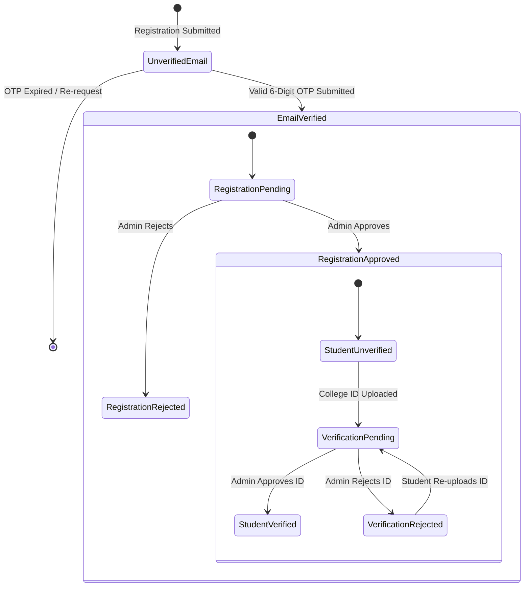

# 📑 Software Requirements Specification (SRS) — Campus Marketplace

- **Project Name:** Campus Marketplace
- **Document Version:** 1.0
- **Status:** Draft / Pending User Approval
- **Cross-References:** [PRD.md](file:///c:/Users/Downe/OneDrive/Documents/Campus_Marketplace_Final/docs/PRD.md) | [TRD.md](file:///c:/Users/Downe/OneDrive/Documents/Campus_Marketplace_Final/docs/TRD.md) | [DATABASE_DESIGN.md](file:///c:/Users/Downe/OneDrive/Documents/Campus_Marketplace_Final/docs/DATABASE_DESIGN.md) | [SECURITY_PLAN.md](file:///c:/Users/Downe/OneDrive/Documents/Campus_Marketplace_Final/docs/SECURITY_PLAN.md)

---

## 1. Introduction

### 1.1. Purpose
This Software Requirements Specification (SRS) defines the functional, operational, and non-functional requirements for the **Campus Marketplace** system. It details the required security behaviors, user access boundaries, life cycle states, use cases, and formal acceptance criteria.

### 1.2. Scope
The application encompasses a client Single Page Application (SPA) interfacing with a native Node.js REST API and MySQL relational storage. This specification covers preserved existing features (catalog, search, selling, UI styling) alongside mandatory new modules (Email OTP delivery, Administrator registration approvals, RBAC enforcement, and scoped peer chat).

---

## 2. Overall System Description & Lifecycle States

### 2.1. Distinct Account Status Architecture
To eliminate ambiguities found during the audit, the system strictly separates three distinct account statuses:

| Lifecycle State Attribute | Data Type | Permitted Values | State Definition & Permissions |
| :--- | :--- | :--- | :--- |
| **1. `email_verified`** | `BOOLEAN` | `false`, `true` | Indicates proof of ownership of the campus email address via a validated one-time password (OTP). When `false`, the user cannot log in or browse restricted areas. |
| **2. `registration_status`** | `ENUM` | `'pending'`, `'approved'`, `'rejected'` | Administrative gate governing site access. Set to `'pending'` upon registration. Only `'approved'` users are granted active login sessions. |
| **3. `student_verification_status`**| `ENUM` | `'unverified'`, `'pending'`, `'verified'`, `'rejected'` | Institutional identity status governing trust badges. Unlocks the `✓ Verified Seller` badge on product listings when `'verified'`. |

---

## 3. Functional Requirements

### 3.1. Authentication & Account Management (AUTH)
- **FR-AUTH-01 (Registration Payload)**: The system shall accept `name` (1–100 chars), `email` (valid institutional format, max 255 chars), and `password` (min 8 chars, containing at least one numeral and one special symbol). *(Proposed enhancement over current 6-char rule)*.
- **FR-AUTH-02 (Password Security)**: Passwords must be hashed using `bcrypt` with a minimum work factor of 12 before persistence. *(Replaces current unsalted SHA-256)*.
- **FR-AUTH-03 (OTP Generation & Dispatch)**: Upon registration, the system shall generate a cryptographically secure 6-digit numeric OTP, save its hash and expiration (10 minutes) in `email_otps`, and dispatch an email via SMTP/transactional provider.
- **FR-AUTH-04 (OTP Validation)**: The system shall expose `POST /api/auth/verify-otp`. Upon successful validation, it shall set `email_verified = true`. If 3 consecutive invalid attempts occur, the OTP is invalidated.
- **FR-AUTH-05 (Registration Approval Gate)**: `POST /api/auth/login` shall strictly check both `email_verified = true` AND `registration_status = 'approved'`. If `registration_status` is `'pending'` or `'rejected'`, authentication is rejected with an explicit, human-readable message and HTTP `403 Forbidden`.
- **FR-AUTH-06 (Session Issuance & Expiry)**: Upon successful login, the system shall issue a 32-byte hexadecimal bearer token persisted with an explicit expiration timestamp (24 hours). Expired tokens must be rejected.
- **FR-AUTH-07 (Session Revocation)**: `POST /api/auth/logout` shall invalidate the active token in the `sessions` table immediately.
- **FR-AUTH-08 (Profile Synchronization)**: `GET /api/me` shall return the current user's profile, roles, and all three status flags.

### 3.2. Role-Based Access Control & Admin Administration (ADMIN)
- **FR-ADMIN-01 (Role Definition)**: The system shall support roles: `'student'` and `'admin'`. Default role upon registration is `'student'`.
- **FR-ADMIN-02 (Backend Authorization Middleware)**: All administrative endpoints (`/api/admin/*`) must enforce admin role verification on the server. If a non-admin token or unauthenticated request is received, the API must return HTTP `403 Forbidden`. Hiding client UI controls is explicitly insufficient.
- **FR-ADMIN-03 (Pending Registrations Queue)**: `GET /api/admin/registrations` shall list all users with `registration_status = 'pending'` and `email_verified = true`.
- **FR-ADMIN-04 (Registration Decision)**: The system shall expose `POST /api/admin/registrations/:id/approve` and `POST /api/admin/registrations/:id/reject` (with optional rejection reason).
- **FR-ADMIN-05 (Verification Review Queue)**: `GET /api/admin/verifications` shall return student verification submissions awaiting review (`status = 'pending'`).
- **FR-ADMIN-06 (Verification Decision)**: `POST /api/admin/verifications/:id/approve` and `reject` shall atomically update the verification record and synchronize `users.student_verification_status`.

### 3.3. Marketplace & Product Management (PROD) — *Preserved & Standardized*
- **FR-PROD-01 (Product Catalog Query)**: The system shall support `GET /api/products` accepting optional URL query parameters `?search=` and `?category=`.
- **FR-PROD-02 (Permitted Categories)**: Allowed categories are strictly restricted to: `Books`, `Electronics`, `Furniture`, `Accessories`.
- **FR-PROD-03 (Product Creation)**: Authenticated and approved students may list products via `POST /api/products` with `name` (max 100 chars), `category`, `price` (positive number), and `description` (max 1000 chars).
- **FR-PROD-04 (Seller Badge Association)**: The product catalog must indicate whether the seller holds `student_verification_status = 'verified'` (`✓ Verified Seller`).
- **FR-PROD-05 (Single Product Inspection)**: `GET /api/products/:id` shall return comprehensive product details, seller name, seller email, and verification status.

### 3.4. Student Identity Verification Workflow (VERIF)
- **FR-VERIF-01 (Verification Submission)**: Authenticated students may submit `studentName`, `studentEmail`, `studentId` (Roll/PRN), `department`, and `documentData` (Base64-encoded image/document max 4 MB).
- **FR-VERIF-02 (MIME & Size Enforcement)**: Client and server must reject uploads larger than 4 MB and restrict formats to `image/jpeg`, `image/png`, `application/pdf`.
- **FR-VERIF-03 (Status Tracking)**: The student UI must reflect the active verification state (`Not Verified`, `Pending Admin Review`, `✓ Verified`, `Rejected`).

### 3.5. Scoped Peer-to-Peer Chat (CHAT)
- **FR-CHAT-01 (Thread Isolation)**: Chat conversations must be scoped to a `(product_id, buyer_id, seller_id)` tuple. A buyer cannot view inquiries sent by other buyers.
- **FR-CHAT-02 (Authorization Check)**: The API shall only permit users to view or post messages in a thread if `currentUser.id === buyer_id` OR `currentUser.id === seller_id`. All other access attempts must return HTTP `403 Forbidden`.
- **FR-CHAT-03 (Thread Creation)**: Clicking "Contact Seller" shall resolve or initialize a private conversation thread.
- **FR-CHAT-04 (Bubble Alignment Contract)**: API responses must clearly identify message ownership so the client reliably renders `sent` (right-aligned) for the active user and `received` (left-aligned) for the counterparty.
- **FR-CHAT-05 (Polled / Live Updates)**: The client shall refresh conversation history at a regular cadence (short-polling every 4 seconds or event-driven) while the chat window is active.

---

## 4. Use Cases

### UC-1: Student Registration & Email OTP Verification
- **Primary Actor**: Prospective Student
- **Preconditions**: User has an institutional email address (`@campus.edu` / `@campus.local`).
- **Main Flow**:
  1. Student fills registration form (Name, Email, Password).
  2. System creates unverified user record with `email_verified = false`, `registration_status = 'pending'`.
  3. System dispatches 6-digit OTP to the provided email.
  4. Client displays OTP input dialog.
  5. Student enters OTP and clicks "Verify Email".
  6. System validates OTP hash and expiry, sets `email_verified = true`.
  7. Client informs student that account registration is pending admin review.
- **Alternative Flow (Invalid OTP)**: If OTP does not match, system decrements attempts counter. After 3 attempts, OTP is voided and student must request a new OTP.

### UC-2: Administrator Registration Approval
- **Primary Actor**: Campus Administrator
- **Preconditions**: Administrator is logged in with `role = 'admin'`.
- **Main Flow**:
  1. Admin opens Admin Portal and clicks "Pending Registrations".
  2. System displays list of users with `email_verified = true` and `registration_status = 'pending'`.
  3. Admin verifies institutional domain/credentials and clicks "Approve".
  4. System updates database: `registration_status = 'approved'`.
  5. Student can now log in successfully.
- **Alternative Flow (Rejection)**: Admin clicks "Reject" with reason. System updates `registration_status = 'rejected'`. Subsequent login attempts by the student are rejected with the recorded reason.

### UC-3: Student ID Verification Submission & Review
- **Primary Actor**: Student Seller & Administrator
- **Preconditions**: Student account is approved and logged in.
- **Main Flow**:
  1. Student navigates to `#verification`, fills details, selects college ID card image, and submits.
  2. System saves payload to `verification_requests` with `status = 'pending'` and sets `users.student_verification_status = 'pending'`.
  3. Admin navigates to "ID Verifications Queue", inspects student ID document.
  4. Admin confirms identity matches profile and clicks "Approve ID".
  5. System sets `users.student_verification_status = 'verified'` and marks request `approved`.
  6. All active and future product listings by the student display `✓ Verified Seller`.

### UC-4: In-Platform Product Inquiry (Scoped Chat)
- **Primary Actor**: Student Buyer & Student Seller
- **Preconditions**: Both users have approved accounts.
- **Main Flow**:
  1. Buyer views "Engineering Mathematics Book" and clicks "Contact Seller".
  2. System resolves thread between Buyer and Seller for that product.
  3. Buyer submits message: "Can we meet at the campus library?".
  4. System inserts message linked to the thread.
  5. Seller opens Chat, views the message, and replies: "Yes, 3 PM works.".
  6. Messages render with correct bubble alignment for both participants.
- **Exception Flow (Unauthorized Reader)**: Third-party user attempts to query the thread endpoint directly. System returns HTTP `403 Forbidden`.

---

## 5. Non-Functional Requirements (NFR)

| ID | Category | Requirement Specification |
| :--- | :--- | :--- |
| **NFR-SEC-01** | Security | All database interactions must use parameterized prepared statements to prevent SQL injection. |
| **NFR-SEC-02** | Security | Passwords must be hashed using `bcrypt` (12 rounds). Plain SHA-256 is strictly prohibited. |
| **NFR-SEC-03** | Security | All user text rendered in the DOM must pass through HTML character entity escaping (`esc()`) to prevent XSS. |
| **NFR-PERF-01**| Performance | Core catalog API query (`GET /api/products`) must respond in < 150 ms under 100 concurrent requests. |
| **NFR-PERF-02**| Performance | File uploads are capped at 4 MB to prevent memory exhaustion and serverless execution timeouts. |
| **NFR-REL-01** | Reliability | Database connection failures must return structured JSON errors (`503 Service Unavailable`) without crashing the Node.js process. |
| **NFR-UI-01**  | Usability | The user interface must preserve the Liquid Glassmorphism styling with seamless responsiveness across mobile (375px+), tablet, and desktop viewports. |

---

## 6. Acceptance Criteria Matrix

| Requirement | Acceptance Test Condition | Expected Outcome |
| :--- | :--- | :--- |
| **FR-AUTH-03** | Register new account with valid details. | Record created; 6-digit numeric OTP sent; `email_verified` is 0. |
| **FR-AUTH-05** | Attempt login with `registration_status = 'pending'`. | HTTP 403 Forbidden; message: "Account registration is pending administrator approval." |
| **FR-ADMIN-02**| Request `/api/admin/registrations` using student Bearer token. | HTTP 403 Forbidden; request rejected. |
| **FR-ADMIN-04**| Admin approves pending student via API. | `users.registration_status` set to `'approved'`; student can now log in. |
| **FR-VERIF-02**| Upload a 6 MB verification document. | Rejected immediately by client/server with error: "File exceeds 4 MB limit." |
| **FR-CHAT-02** | User B attempts to read chat thread between User A and User C. | HTTP 403 Forbidden; access denied. |
