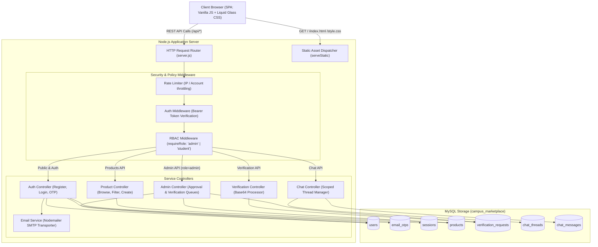

# 🛠 Technical Requirements Document (TRD) — Campus Marketplace

- **Project Name:** Campus Marketplace
- **Document Version:** 1.0
- **Status:** Draft / Pending User Approval
- **Cross-References:** [PRD.md](file:///c:/Users/Downe/OneDrive/Documents/Campus_Marketplace_Final/docs/PRD.md) | [SRS.md](file:///c:/Users/Downe/OneDrive/Documents/Campus_Marketplace_Final/docs/SRS.md) | [DATABASE_DESIGN.md](file:///c:/Users/Downe/OneDrive/Documents/Campus_Marketplace_Final/docs/DATABASE_DESIGN.md) | [SECURITY_PLAN.md](file:///c:/Users/Downe/OneDrive/Documents/Campus_Marketplace_Final/docs/SECURITY_PLAN.md)

---

## 1. Verified Current Technology Stack (Baseline from Audit)

Based on the audit of [package.json](file:///c:/Users/Downe/OneDrive/Documents/Campus_Marketplace_Final/package.json), [server.js](file:///c:/Users/Downe/OneDrive/Documents/Campus_Marketplace_Final/server.js), and [public/](file:///c:/Users/Downe/OneDrive/Documents/Campus_Marketplace_Final/public/):

```plaintext
[Client Browser]
       │
       ▼ (HTTP / REST)
[Node.js Native HTTP Server] (server.js - zero framework)
       │
       ▼ (mysql2/promise connection pool)
[MySQL Database] (localhost:3306 - campus_marketplace)
```

| Layer | Component | Verified Implementation | Source Code Evidence |
| :--- | :--- | :--- | :--- |
| **Runtime** | Node.js | v18+; Native `http.createServer` handling routing and static file serving | [server.js:L1697-L1761](file:///c:/Users/Downe/OneDrive/Documents/Campus_Marketplace_Final/server.js#L1697-L1761) |
| **Database** | MySQL | `mysql2/promise` with connection pool (`connectionLimit: 10`, `waitForConnections: true`) | [server.js:L30-L40](file:///c:/Users/Downe/OneDrive/Documents/Campus_Marketplace_Final/server.js#L30-L40) |
| **Environment**| `dotenv` | Loaded at startup (`require("dotenv").config()`) | [server.js:L1](file:///c:/Users/Downe/OneDrive/Documents/Campus_Marketplace_Final/server.js#L1) |
| **Cryptography**| Native `crypto` | Unsalted SHA-256 password hashing; 32-byte hex tokens | [server.js:L120-L128](file:///c:/Users/Downe/OneDrive/Documents/Campus_Marketplace_Final/server.js#L120-L128) |
| **Frontend UI** | HTML5 / CSS3 | Single-page application; Liquid Glassmorphism design system; ambient radial animations | [public/index.html](file:///c:/Users/Downe/OneDrive/Documents/Campus_Marketplace_Final/public/index.html), [public/style.css](file:///c:/Users/Downe/OneDrive/Documents/Campus_Marketplace_Final/public/style.css) |
| **Frontend App**| Vanilla JS | ES6+ fetch wrapper (`api()`), LocalStorage token caching, hashless tab switcher | [public/script.js](file:///c:/Users/Downe/OneDrive/Documents/Campus_Marketplace_Final/public/script.js#L20-L48) |

---

## 2. Target Technical Stack & Planned Additions

To satisfy the mandatory requirements without introducing framework bloat, the target architecture expands dependencies minimally:

| Purpose | Technology / Library | Version / Type | Rationale |
| :--- | :--- | :--- | :--- |
| **Password Hashing** | `bcrypt` (or `bcryptjs`) | `^5.1.1` | Replaces plain SHA-256 with adaptive, salted blowfish cryptographic hashing (12 salt rounds). |
| **Email Delivery** | `nodemailer` | `^6.9.10` | Standard, reliable Node.js SMTP email client for delivering 6-digit OTP verification codes. |
| **Configuration** | `dotenv` (Current) | `^18.0.0` | Already present; expanded for SMTP configuration (`SMTP_HOST`, `SMTP_PORT`, `SMTP_USER`, `SMTP_PASS`). |
| **Database Client** | `mysql2` (Current) | `^3.24.4` | Already present; continues handling connection pooling and prepared statements. |
| **Frontend** | Vanilla HTML/CSS/JS | Native ES6+ | Preserves instant load times, zero build-step overhead, and existing Liquid Glass design tokens. |

---

## 3. System Architecture & Request Lifecycle



---

## 4. Technical Constraints & Design Parameters

### 4.1. Serverless & Deployment Constraints
- **Vercel Serverless Invocation**: The server exports `module.exports = server;` ([server.js:L1885](file:///c:/Users/Downe/OneDrive/Documents/Campus_Marketplace_Final/server.js#L1885)). Serverless execution environments have ephemeral filesystems and strict request execution limits (10–15 seconds default timeout).
- **In-Database File Storage**: Verification documents cannot be stored on local disk in production because serverless storage is destroyed between cold boots. Documents are persisted directly in MySQL as `LONGTEXT` Base64 strings.
- **Request Payload Limit**: Hard-capped at `4 MB` ([server.js:L139](file:///c:/Users/Downe/OneDrive/Documents/Campus_Marketplace_Final/server.js#L139)) to avoid Vercel payload rejection and excessive memory footprint during concurrent uploads.

### 4.2. Database Connection Pooling Constraints
- **Pool Size**: Configured to `10` simultaneous connections ([server.js:L38](file:///c:/Users/Downe/OneDrive/Documents/Campus_Marketplace_Final/server.js#L38)).
- **Queuing**: `queueLimit: 0` ensures requests queue smoothly during traffic spikes rather than immediately failing.
- **Query Execution**: Every dynamic query MUST use parameterized placeholders (`?`) via `pool.execute(sql, params)`. Concatenating SQL strings is strictly forbidden.

### 4.3. UI & Frontend Constraints
- **Zero Framework Dependency**: No React, Vue, or Tailwind build tooling. All code must execute directly in standard modern evergreen browsers.
- **Single Page Navigation**: Seamless tab switching without browser page reloads via `showPage(pageId)`.
- **CSS Architecture**: Preserved Liquid Glassmorphism design system in [public/style.css](file:///c:/Users/Downe/OneDrive/Documents/Campus_Marketplace_Final/public/style.css), retaining custom properties, backdrop filters, and gradient circles.

---

## 5. Security & Cryptographic Specifications

| Component | Current Implementation | Target Specification |
| :--- | :--- | :--- |
| **Password Hashing** | Plain SHA-256 (`crypto.createHash("sha256")`) | `bcrypt.hash(password, 12)` |
| **OTP Generation** | None (Missing) | Cryptographic 6-digit integer (`crypto.randomInt(100000, 999999)`); stored as SHA-256 hash with 10-minute expiry |
| **Session Tokens** | 32-byte hex (`crypto.randomBytes(32).toString("hex")`) | Preserved 32-byte hex; added explicit `expires_at = NOW() + INTERVAL 24 HOUR` |
| **Authorization Check** | None (Any user is treated as student) | Server-side RBAC middleware inspecting `user.role` from sessions join |
| **Chat Isolation** | Open query by `product_id` | Enforced tuple match: `WHERE thread_id = ? AND (buyer_id = ? OR seller_id = ?)` |

---

## 6. Technical Risks & Unverified Assumptions (Audit Flags)

> [!WARNING]
> **Items Requiring User / Environment Confirmation:**
> 1. **SMTP Credentials**: An active SMTP server (Gmail App Password, SendGrid, Amazon SES, or Mailgun) must be configured in `.env` to enable live OTP delivery. *(In development, a local logger or Ethereal test account can be used as fallback).*
> 2. **Database Version Compatibility**: MySQL 8.0+ is assumed for `TIMESTAMP DEFAULT CURRENT_TIMESTAMP` and `JSON`/`LONGTEXT` support.
> 3. **Production Host Target**: If deployed to Vercel, MySQL must be remotely accessible (e.g., PlanetScale, AWS RDS, Aiven, or Supabase MySQL). If hosted on a VPS (Ubuntu/DigitalOcean), local MySQL `localhost:3306` is valid.
