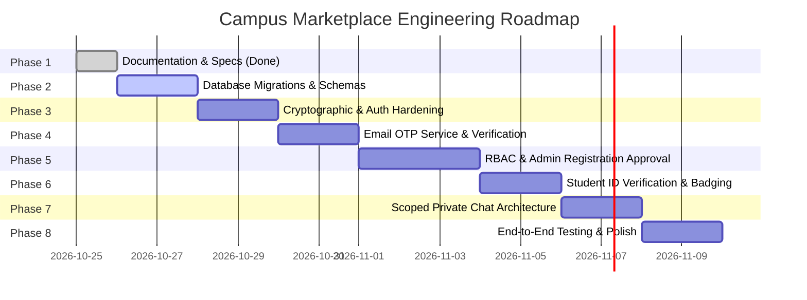

# 📊 Work Breakdown Structure (WBS) — Campus Marketplace

- **Project Name:** Campus Marketplace
- **Document Version:** 1.0
- **Status:** Draft / Pending User Approval
- **Cross-References:** [PRD.md](file:///c:/Users/Downe/OneDrive/Documents/Campus_Marketplace_Final/docs/PRD.md) | [SRS.md](file:///c:/Users/Downe/OneDrive/Documents/Campus_Marketplace_Final/docs/SRS.md) | [TRD.md](file:///c:/Users/Downe/OneDrive/Documents/Campus_Marketplace_Final/docs/TRD.md) | [DATABASE_DESIGN.md](file:///c:/Users/Downe/OneDrive/Documents/Campus_Marketplace_Final/docs/DATABASE_DESIGN.md)

---

## 1. Project Phasing & Milestone Road Map

The development plan decomposes the project into 8 sequential, risk-mitigated phases:



---

## 2. Detailed Work Breakdown by Phase

### Phase 1: Planning, Documentation & Baseline Architecture *(Current Milestone)*
- **WBS 1.1**: Complete audit of existing codebase, dependencies, and database schemas. *(Completed)*
- **WBS 1.2**: Author core architecture and specification documents:
  - `PRD.md`, `SRS.md`, `TRD.md`, `WBS.md`, `DATABASE_DESIGN.md`, `SECURITY_PLAN.md`, `TEST_PLAN.md`, `RISK_REGISTER.md`. *(In progress)*
- **WBS 1.3**: Align on three-tier account lifecycle and role boundaries.
- **Deliverables**: Comprehensive documentation package under `docs/`.
- **Dependencies**: None.

---

### Phase 2: Database Schema & Migration Foundation
- **WBS 2.1**: Author `init_db.sql` or non-destructive migration script in [server.js](file:///c:/Users/Downe/OneDrive/Documents/Campus_Marketplace_Final/server.js).
- **WBS 2.2**: Update `users` table:
  - Add `role` (`ENUM('student', 'admin') DEFAULT 'student'`).
  - Add `email_verified` (`BOOLEAN DEFAULT 0`).
  - Add `registration_status` (`ENUM('pending', 'approved', 'rejected') DEFAULT 'pending'`).
  - Add `student_verification_status` (`ENUM('unverified', 'pending', 'verified', 'rejected') DEFAULT 'unverified'`).
  - Expand `password_hash` column to `VARCHAR(255)` for `bcrypt` hashes.
- **WBS 2.3**: Create `email_otps` table (`id`, `email`, `otp_hash`, `expires_at`, `attempts`, `created_at`).
- **WBS 2.4**: Update `sessions` table to add `expires_at` (`TIMESTAMP`).
- **WBS 2.5**: Refactor `verification` table to `verification_requests` with `reviewed_by` and `reviewed_at`.
- **WBS 2.6**: Create `chat_threads` table and update `chats` to reference `thread_id`.
- **Deliverables**: Clean MySQL schema ready for production deployment.
- **Dependencies**: Phase 1 approval.

---

### Phase 3: Cryptographic & Auth Hardening
- **WBS 3.1**: Install and configure `bcrypt` (or `bcryptjs`).
- **WBS 3.2**: Replace SHA-256 password hashing in registration and login with `bcrypt.hash(password, 12)` and `bcrypt.compare()`.
- **WBS 3.3**: Update session validation (`getCurrentUser`) to check `s.expires_at > NOW()`.
- **WBS 3.4**: Clean up expired sessions periodically via database query or middleware trigger.
- **Deliverables**: Tamper-proof, salted password security and expiring session tokens.
- **Dependencies**: Phase 2.

---

### Phase 4: Email Service & OTP Verification Module
- **WBS 4.1**: Install `nodemailer` and configure SMTP transport via `.env`.
- **WBS 4.2**: Implement `emailService.js` with HTML email templates styled with Campus Marketplace branding.
- **WBS 4.3**: Implement OTP generator (6-digit numeric, SHA-256 hash storage, 10-minute expiry).
- **WBS 4.4**: Implement endpoints:
  - `POST /api/auth/verify-otp` (validates OTP, sets `email_verified = true`).
  - `POST /api/auth/resend-otp` (rate-limited resend).
- **WBS 4.5**: Add frontend modal in [public/index.html](file:///c:/Users/Downe/OneDrive/Documents/Campus_Marketplace_Final/public/index.html) and [public/script.js](file:///c:/Users/Downe/OneDrive/Documents/Campus_Marketplace_Final/public/script.js) for entering the 6-digit OTP code.
- **Deliverables**: Working institutional email verification system.
- **Dependencies**: Phase 3.

---

### Phase 5: Role-Based Admin Management & Registration Approvals
- **WBS 5.1**: Implement backend RBAC middleware (`requireRole(['admin'])`) in [server.js](file:///c:/Users/Downe/OneDrive/Documents/Campus_Marketplace_Final/server.js).
- **WBS 5.2**: Update `POST /api/auth/login` to enforce `registration_status === 'approved'`.
- **WBS 5.3**: Build Admin API endpoints:
  - `GET /api/admin/registrations` (lists pending student registrations).
  - `POST /api/admin/registrations/:id/approve` (sets `registration_status = 'approved'`).
  - `POST /api/admin/registrations/:id/reject` (sets `registration_status = 'rejected'`).
- **WBS 5.4**: Create modern Liquid Glass Admin Portal section (`#admin`) in [public/index.html](file:///c:/Users/Downe/OneDrive/Documents/Campus_Marketplace_Final/public/index.html).
- **WBS 5.5**: Add frontend logic to dynamically show Admin navigation link only for `role === 'admin'`.
- **Deliverables**: Administrator registration review dashboard with backend permission enforcement.
- **Dependencies**: Phase 4.

---

### Phase 6: Student Identity Verification & Admin Review
- **WBS 6.1**: Update `POST /api/verification` to set `users.student_verification_status = 'pending'`.
- **WBS 6.2**: Implement Admin verification review endpoints:
  - `GET /api/admin/verifications` (retrieves pending student ID submissions).
  - `POST /api/admin/verifications/:id/approve` (sets user to `'verified'`).
  - `POST /api/admin/verifications/:id/reject` (records rejection).
- **WBS 6.3**: Build Admin ID card preview modal with zoom/inspect capabilities.
- **WBS 6.4**: Ensure all active and new product listings by verified students immediately render the `✓ Verified Seller` badge.
- **WBS 6.5**: Fix contract mismatch in [public/script.js](file:///c:/Users/Downe/OneDrive/Documents/Campus_Marketplace_Final/public/script.js#L234) to safely render verification response.
- **Deliverables**: Complete student ID verification review and badging cycle.
- **Dependencies**: Phase 5.

---

### Phase 7: Scoped Private Chat Architecture
- **WBS 7.1**: Implement `chat_threads` model linking `product_id`, `buyer_id`, and `seller_id`.
- **WBS 7.2**: Implement endpoints:
  - `POST /api/chats/thread` (finds or initiates a private thread between buyer and seller).
  - `GET /api/chats/thread/:threadId` (retrieves messages strictly for authorized participants).
  - `POST /api/chats/thread/:threadId` (appends message).
- **WBS 7.3**: Enforce strict authorization check: rejecting any user not matching `buyer_id` or `seller_id` with HTTP 403.
- **WBS 7.4**: Fix chat bubble styling in [public/script.js](file:///c:/Users/Downe/OneDrive/Documents/Campus_Marketplace_Final/public/script.js#L421) (`sent` vs `received`).
- **WBS 7.5**: Implement client-side short-polling (4s interval) while chat is open.
- **Deliverables**: Secure, private, product-anchored chat system.
- **Dependencies**: Phase 5.

---

### Phase 8: Testing, Clean-up & Deployment Readiness
- **WBS 8.1**: Consolidate repository structure; isolate or clean nested `Campus_Marketplace_Final/` folder.
- **WBS 8.2**: Execute comprehensive test matrix defined in [TEST_PLAN.md](file:///c:/Users/Downe/OneDrive/Documents/Campus_Marketplace_Final/docs/TEST_PLAN.md).
- **WBS 8.3**: Add standard security headers (`Content-Security-Policy`, `X-Content-Type-Options`).
- **WBS 8.4**: Update documentation and seed default admin account (`admin@campus.local`).
- **Deliverables**: Production-grade, fully audited platform ready for deployment.
- **Dependencies**: Phases 1–7.

---

## 3. Critical Path & Dependency Flow

```plaintext
[Phase 1: Docs & Specs] 
       │
       ▼
[Phase 2: Database Schema & Migrations]
       │
       ▼
[Phase 3: Cryptography & Auth Hardening]
       │
       ▼
[Phase 4: Email OTP Verification]
       │
       ▼
[Phase 5: RBAC & Admin Registration Approval]
       ├──► [Phase 6: Student ID Verification Review]
       └──► [Phase 7: Scoped Private Chat Architecture]
                   │
                   ▼
       [Phase 8: End-to-End Testing & Final Polish]
```
